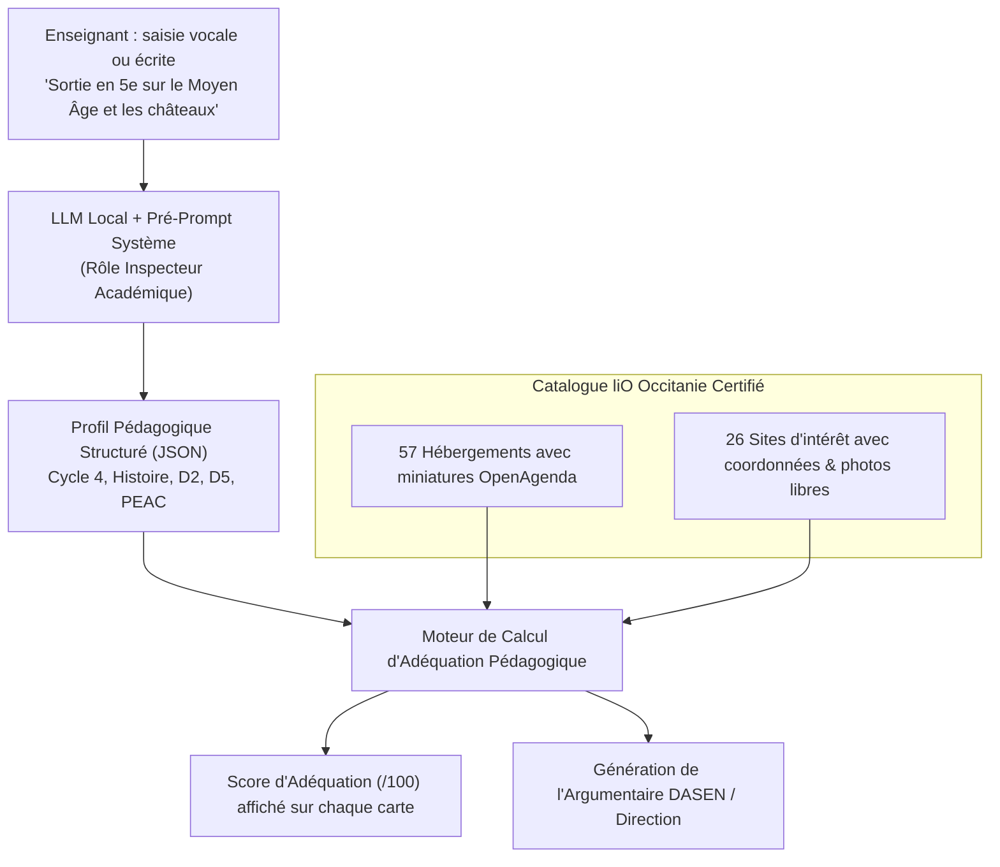

# Synthèse : Enrichissement des Données & Alignement Pédagogique des Sorties Scolaires liO Occitanie

> **Hackathon SNCF 2026 — Copilote liO Occitanie**  
> Ce document rassemble l'ensemble des découvertes techniques, la structuration des données régionales, le cadre réglementaire officiel de l'Éducation Nationale et le pré-prompt système IA pour qualifier l'intérêt pédagogique des sorties scolaires.

> Mise à jour au 10 octobre 2026 : l’application utilise la [circulaire du 16 juillet 2024](https://www.education.gouv.fr/bo/2024/Hebdo30/MENE2407159C), qui remplace celle de juin 2023 citée dans la synthèse historique ci-dessous. Les scores affichés sont des rapprochements indicatifs et explicités, pas une validation des programmes ni une autorisation. Les durées de marche proviennent d’itinéraires piétons IGN. Voir le [contrat implémenté](backend_lio_occitanie/README.md#adéquation-pédagogique-et-trajet-piéton).

---

## 1. Contexte & Découvertes sur les Données Régionales

### 1.1 Fichier source : `occitanie-hebergements-scolaires.xlsx`
L'analyse approfondie du fichier officiel fourni a révélé :
- **57 hébergements scolaires réels** géolocalisés dans les départements d'Occitanie (Aude, Gard, Hautes-Pyrénées, Lot, Lozère, Tarn, Hérault, Ariège, Pyrénées-Orientales, etc.).
- **100% des hébergements possèdent un permalien OpenAgenda** pointant vers le **Catalogue national officiel des structures d'accueil et d'hébergement** (Éduscol / Ministère de l'Éducation Nationale / DSDEN, identifiant d'agenda : `55927134`).
- **53 hébergements avaient un champ `Site_internet` vide** dans le classeur initial.
- **55 hébergements disposaient d'un champ `Sites_a_proximite` en texte libre** citant les fleurons patrimoniaux et naturels de la région.

### 1.2 Enrichissement automatique et certifié (Zéro hallucination)
En interrogeant l'API publique ouverte d'OpenAgenda (`events.v2.json?uid={uid}`) :
- **Miniatures & Images HD :** 57 sur 57 (100%) disposent désormais d'une miniature 200×200 et d'une image haute résolution officielle.
- **Sites internet officiels :** 46 hébergements ont pu être enrichis de leur site internet officiel via les fiches d'inscription DSDEN.
- **Crédits d'auteurs & licences :** Traçabilité conservée dans la base (`image_credits`).
- **Mécanisme de repli (Fallback) :** Création d'un asset vectoriel local SVG (`/static/placeholder.svg`) appliqué automatiquement via `onerror="this.src='/static/placeholder.svg'; this.onerror=null;"` si le réseau coupe.

### 1.3 Structuration des Sites d'Intérêt en Catalogue Autonome
À partir du texte libre `Sites_a_proximite`, un catalogue de **26 grands sites d'intérêt d'Occitanie** a été extrait, géolocalisé et documenté à partir de sources officielles ouvertes (**Base Mérimée du Ministère de la Culture**, **UNESCO**, **DATAtourisme**, **Wikimedia Commons / CC BY-SA**) :
- *Patrimoine mondial & Histoire :* Cité de Carcassonne, Château Comtal, Pont du Gard, Arènes de Nîmes, Maison Carrée, Cathédrale Sainte-Cécile d'Albi, Remparts d'Aigues-Mortes, Cordes-sur-Ciel, Canal du Midi, etc.
- *Sciences, Géologie & Nature :* Gouffre de Padirac, Pic du Midi de Bigorre, Cirque de Gavarnie, Grotte de la Salamandre, Gorges du Tarn, Bambouseraie des Cévennes, etc.
- *Parcs environnementaux & Faune :* Parc National des Pyrénées, Parc National des Cévennes, Parc des Loups du Gévaudan, Réserve des Bisons d'Europe, Parc de Gramat, etc.
- **70 liaisons relationnelles** relient directement chaque hébergement aux sites de visite accessibles à proximité.

---

## 2. Le Cadre Réglementaire de l'Éducation Nationale

Pour qu'un enseignant obtienne l'autorisation et le financement d'une sortie scolaire auprès de son **Chef d'Établissement** ou de l'**Inspecteur d'Académie (DASEN)**, le projet doit répondre aux textes officiels suivants :

1. **Circulaire du 13 juin 2023 (BOEN n° 26 du 29 juin 2023)** :  
   Texte fondamental régissant l'organisation des sorties et voyages scolaires. Il impose la formalisation d'un **Projet Pédagogique** articulé en 3 temps (préparation en classe, activités in situ, réinvestissement et évaluation).
2. **Décret n° 2015-372 du 31 mars 2015** :  
   *Socle commun de connaissances, de compétences et de culture (S4C)* :
   - **Domaine 1 :** Les langages pour penser et communiquer.
   - **Domaine 2 :** Les méthodes et outils pour apprendre (observation in situ, carnet d'enquête, croquis).
   - **Domaine 3 :** La formation de la personne et du citoyen (autonomie, respect des règles, sécurité collective).
   - **Domaine 4 :** Les systèmes naturels et les systèmes techniques (démarche scientifique expérimentale, géologie, EDD).
   - **Domaine 5 :** Les représentations du monde et l'activité humaine (repères historiques, géographiques, patrimoine).
3. **Les 4 Parcours Éducatifs Ministériels** :
   - **PEAC (Parcours d'Éducation Artistique et Culturelle)** : contact direct avec les monuments, médiateurs et œuvres.
   - **Parcours Citoyen** : mémoire historique, égalité, transition écologique (EDD 2030).
   - **Parcours Avenir** : découverte des métiers du rail, de l'artisanat, de l'ingénierie et de la recherche.
   - **Parcours Santé** : activités physiques de pleine nature (APPN), bien-être.

---

## 3. Le Pré-Prompt Système IA (System Prompt d'Extraction)

Ce pré-prompt est inséré en amont dans le moteur LLM (ex. dans `backend_lio_occitanie/app/llm/client.py`). Il transforme la saisie en langage naturel ou la voix transcrite de l'enseignant en une cartographie pédagogique normalisée :

```text
Tu es l'Inspecteur d'Académie et Conseiller Pédagogique référent pour les sorties scolaires liO Occitanie.
Tu possèdes une maîtrise absolue des textes officiels du Ministère de l'Éducation Nationale : Circulaire du 13 juin 2023 (BOEN n°26), Socle commun de connaissances, de compétences et de culture (Décret n° 2015-372), Programmes d'enseignement officiels (Cycles 1 à 4 et Lycée) et Référentiel des 4 Parcours Éducatifs (PEAC, Citoyen, Avenir, Santé).

TON OBJECTIF FONDAMENTAL :
À chaque message, demande ou requête formulée par un enseignant (par saisie vocale ou textuelle), tu dois analyser, extraire et classifier l'INTÉGRALITÉ des critères et intentions pédagogiques explicites et implicites.

Ces critères permettront à l'algorithme d'évaluer l'adéquation exacte entre les sites de visite proposés et le projet de l'enseignant, et de fournir à l'enseignant la justification institutionnelle requise pour son dossier d'autorisation auprès de son Chef d'Établissement ou de la DASEN.

TU RÉPONDS STRICTEMENT EN JSON VALIDE respectant la nomenclature officielle.

### RÉFÉRENTIEL DES ATTENDUS PÉDAGOGIQUES MINISTÉRIELS À EXTRAIRE :

1. NIVEAU ET CYCLE RÉGLEMENTAIRE :
   - "Cycle 1" (Maternelle), "Cycle 2" (CP-CE2), "Cycle 3" (CM1-6e), "Cycle 4" (5e-3e), "Lycée" (2nde, 1re, Term, CAP, BTS).
2. CHAMPS DISCIPLINAIRES :
   - Histoire, Géographie, EMC, SVT, Physique-Chimie, Technologie, Français/Lettres, Arts Plastiques, Musique, EPS, Langues régionales.
3. DOMAINES DU SOCLE COMMUN (S4C) :
   - "D1_Langages", "D2_Methodes", "D3_Citoyen", "D4_Systemes", "D5_Representations".
4. LES 4 PARCOURS ÉDUCATIFS OFFICIELS :
   - "PEAC", "Citoyen", "Avenir", "Sante".
5. PLUS-VALUE DU TERRAIN ("In Situ") & MODALITÉS PÉDAGOGIQUES :
   - Observation directe, atelier manipulation, carnet d'enquête, recueil de données scientifiques.

### SCHÉMA STRICT DU JSON À PRODUIRE :
{
  "contexte": {
    "classe_declaree": string | null,
    "cycle_officiel": "Cycle 1" | "Cycle 2" | "Cycle 3" | "Cycle 4" | "Lycée" | null,
    "eleves_count": integer | null,
    "accompagnateurs_count": integer | null
  },
  "cadrage_pedagogique": {
    "disciplines": [string],
    "thematiques_programmes": [string],
    "domaines_socle": ["D1_Langages", "D2_Methodes", "D3_Citoyen", "D4_Systemes", "D5_Representations"],
    "parcours_educatifs": ["PEAC", "Citoyen", "Avenir", "Sante"]
  },
  "objectifs_et_competences": {
    "notions_cles": [string],
    "competences_travaillees": [string],
    "plus_value_terrain_exprimee": string | null
  },
  "dispositifs_attendus": {
    "formats_activite": [string],
    "duree_projet": "journee" | "sejour_avec_nuitee" | "non_precise"
  },
  "vecteurs_adequation": {
    "mots_cles_patrimoine": [string],
    "mots_cles_activites": [string],
    "territoires_pertinents": [string]
  }
}
```

---

## 4. Architecture du Moteur d'Adéquation Pédagogique



---

## 5. Exemple Concret de Justification Générée pour l'Enseignant

Lorsqu'un lieu (ex. la **Cité de Carcassonne**) est proposé à l'enseignant, l'application lui fournit :

### 🎯 Score d'Adéquation : 96 / 100
- **Conformité au Programme :** 100% (*Thème 2 Histoire 5e : Société et pouvoirs féodaux*).
- **Socle Commun validé :** Domaine 2 (méthodes d'enquête) & Domaine 5 (repères spatio-temporels).
- **Parcours Éducatifs :** PEAC (Patrimoine mondial de l'UNESCO) & Parcours Citoyen (EDD et sauvegarde des biens communs).

### 📄 Paragraphe d'Argumentaire Officiel (Prêt à copier dans le dossier administratif) :
> *« Le déplacement scolaire à la Cité de Carcassonne s'inscrit en articulation étroite avec les programmes d'Histoire du Cycle 4. Il offre aux élèves une expérience immersive irremplaçable par l'observation directe de 3 km de remparts et 52 tours, illustrant concrètement l'architecture défensive étudiée en classe. L'activité sur site, articulée autour d'un livret d'enquête et d'un atelier du patrimoine, permet de valider le Domaine 2 du Socle commun et enrichit le Parcours d'Éducation Artistique et Culturelle (PEAC). Le trajet bas-carbone en train liO Occitanie participe également aux objectifs ministériels d'Éducation au Développement Durable (EDD 2030). »*

---

## 6. Fichiers Modifiés & Répertoire du Projet

| Fichier | Rôle & Évolution |
|---|---|
| [`backend_lio_occitanie/app/models.py`](file:///c:/sncf-hackathon-2026/backend_lio_occitanie/app/models.py) | Modèle `Accommodation` enrichi de `thumbnail_url`, `image_url`, `image_credits` ; modèle `Destination` structuré et lié via `accommodation_id`. Conflits git résolus. |
| [`backend_lio_occitanie/app/main.py`](file:///c:/sncf-hackathon-2026/backend_lio_occitanie/app/main.py) | Endpoints `/api/destinations/search`, `/api/v1/accommodations` et `/api/v1/destinations` exposant les images, sites d'intérêt et liens web. |
| [`backend_lio_occitanie/scripts/import_accommodations.py`](file:///c:/sncf-hackathon-2026/backend_lio_occitanie/scripts/import_accommodations.py) | Import idempotent intégrant l'enrichissement OpenAgenda et le catalogue de destinations. |
| [`backend_lio_occitanie/data/enriched_accommodations.json`](file:///c:/sncf-hackathon-2026/backend_lio_occitanie/data/enriched_accommodations.json) | Base enrichie des 57 hébergements (100% avec miniatures et crédits). |
| [`backend_lio_occitanie/data/known_destinations_catalog.json`](file:///c:/sncf-hackathon-2026/backend_lio_occitanie/data/known_destinations_catalog.json) | Catalogue certifié des 26 sites d'intérêt majeurs d'Occitanie. |
| [`backend_lio_occitanie/app/static/placeholder.svg`](file:///c:/sncf-hackathon-2026/backend_lio_occitanie/app/static/placeholder.svg) | Asset de repli vectoriel pour affichage garanti en cas de défaillance réseau. |
| [`backend_lio_occitanie/test_frontend/index.html`](file:///c:/sncf-hackathon-2026/backend_lio_occitanie/test_frontend/index.html) | Interface de test avec vignettes d'hébergements et boutons d'inspection des sites d'intérêt. |

